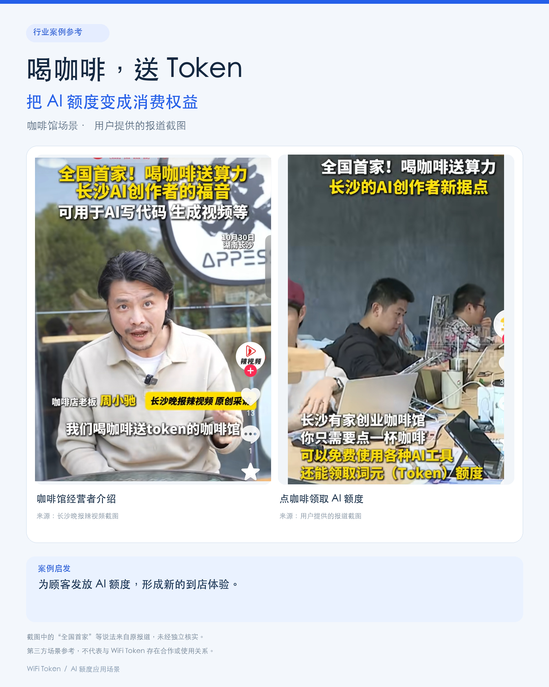
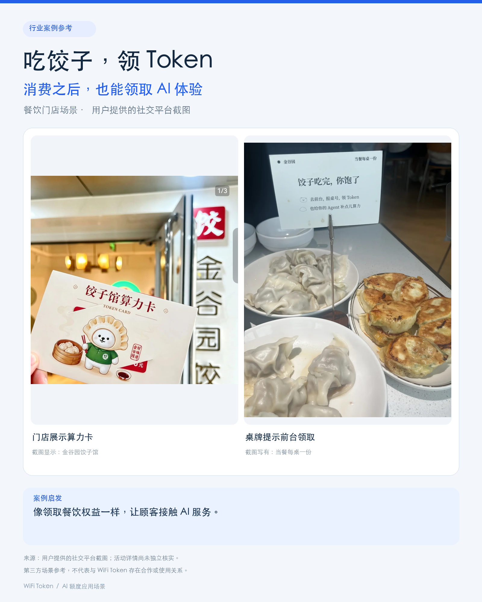
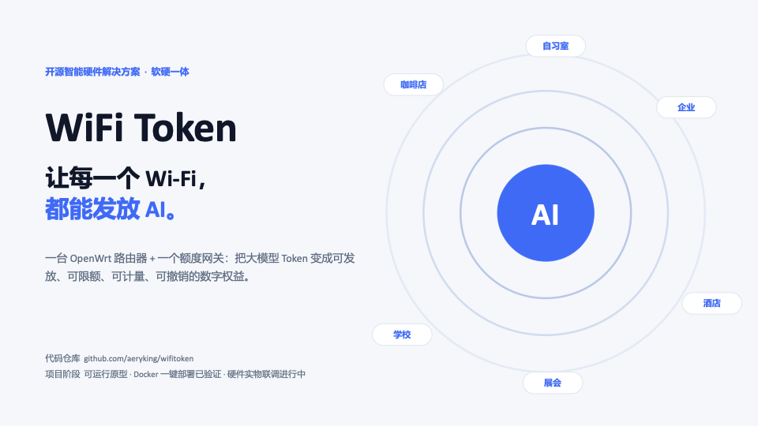
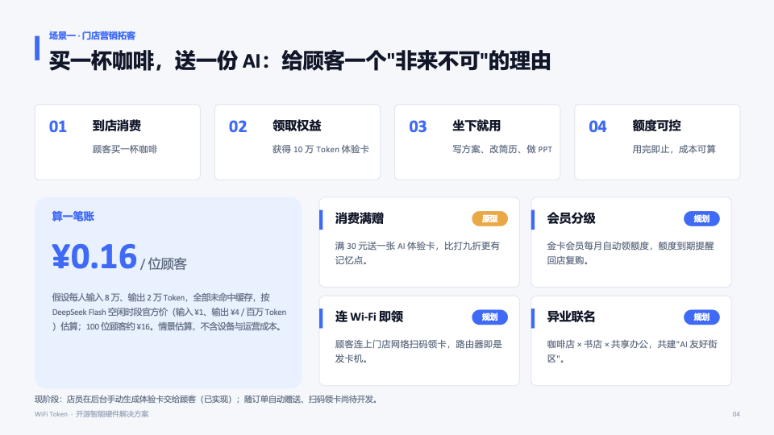
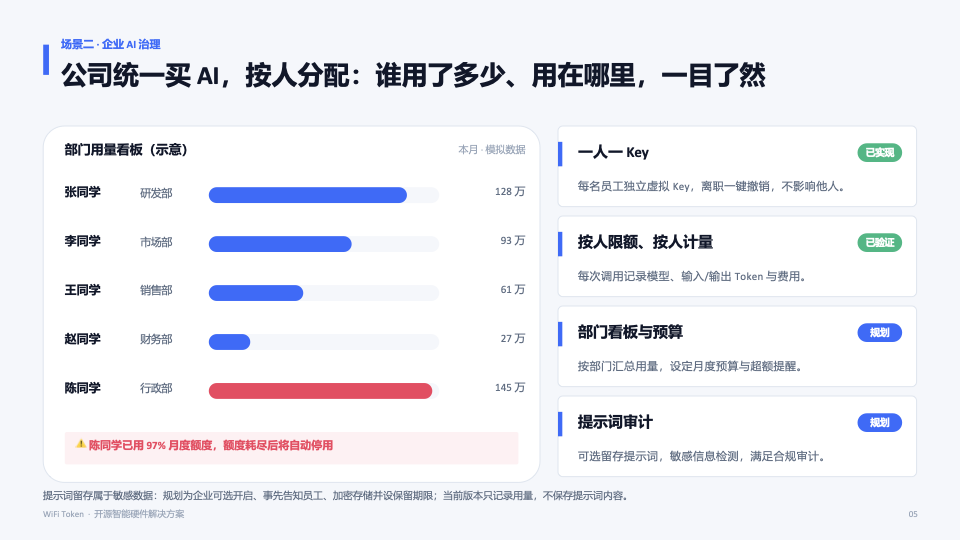
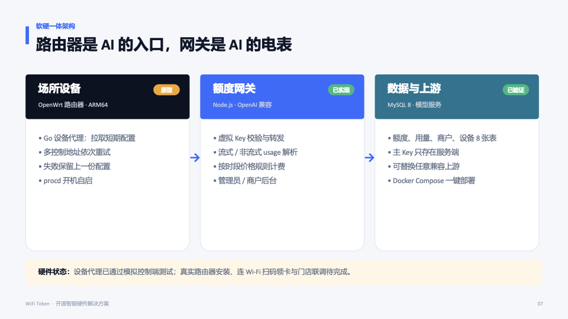
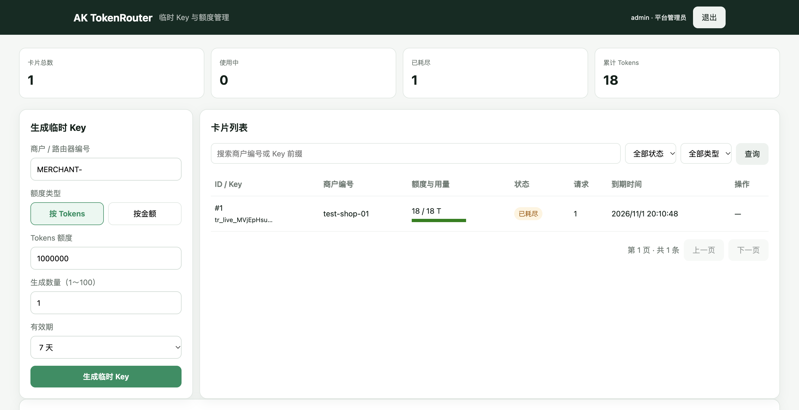
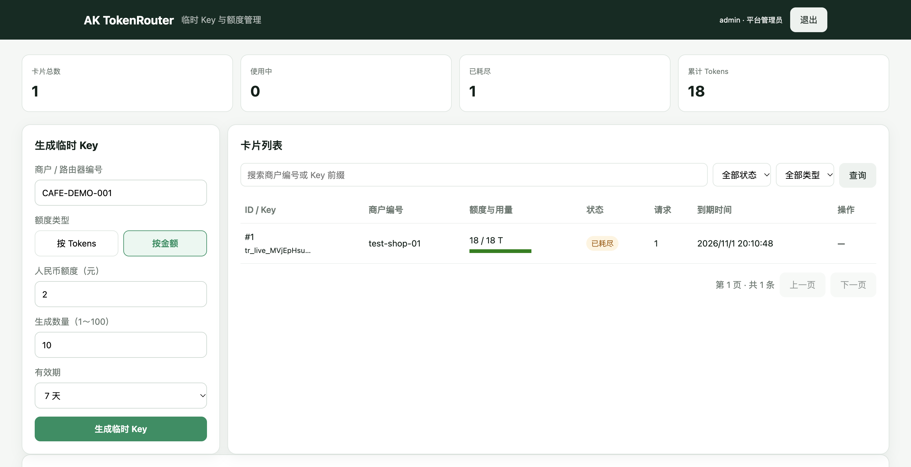
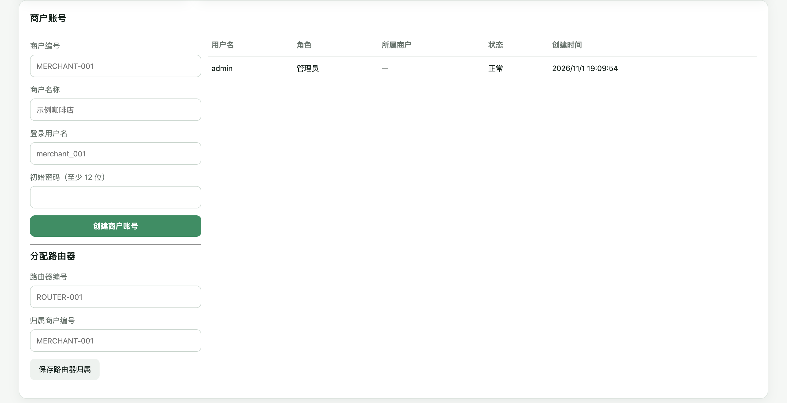
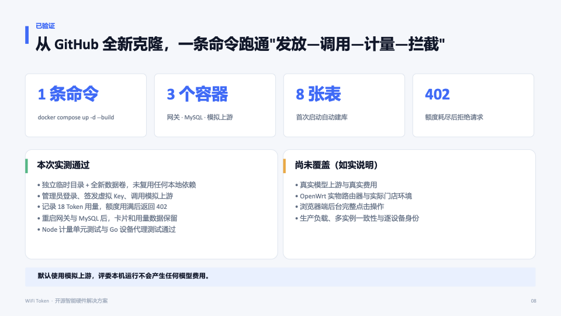

<div align="center">

# WiFi Token

### 让每一个场所，都能发放可管理的 AI 额度

为咖啡店、酒店、企业等场景设计的 **AI Token 接入与额度管理原型**。<br>
发放虚拟 Key，控制使用额度，记录调用用量，让 AI 能力像场所权益一样被分配。

[快速开始](#-快速开始docker-一键部署) · [源码部署](#-源码部署nodejs--mysql) · [OpenWrt 设备](#-openwrt-设备代理) · [作品介绍 PDF](docs/WiFiToken-作品介绍.pdf) · [项目状态](#-项目状态与边界)

</div>

## ☕ 行业场景参考：消费也能送 AI 额度

咖啡馆和餐饮门店已经出现“消费领 Token”的探索。以下为第三方公开内容的截图案例，仅作场景参考，**不代表商家使用了 WiFi Token 或与本项目存在合作关系**；活动细节及原报道中的“全国首家”等说法未经独立核实。

<p align="center">
  <a href="docs/case-posters/案例海报-咖啡馆送Token.png"></a>
  <a href="docs/case-posters/案例海报-饺子馆送Token.png"></a>
</p>



> **当前阶段：可运行原型。** Docker 环境默认接入本地模拟模型，便于体验发卡、调用和计量。扫码领卡、订单自动赠送、提示词审计和真实门店部署等仍在规划或验证中。

## ☕ 可以用来做什么？

### ☕ 门店营销：买咖啡，送 AI 额度

商家可发放限额虚拟 Key，作为购买咖啡后的 AI 体验权益。后续可探索会员赠送、活动兑换和跨店联名。

当前通过后台手动发卡；消费订单对接、自动赠送及扫码领取尚未实现。

### 🏢 企业分配：每人一把虚拟 Key

企业可为成员分配额度，通过请求记录了解用量，并在需要时撤销 Key。

部门看板、预算提醒、提示词记录和审计属于规划能力；当前不保存提示词。





> 图中商家活动、企业看板和人数数据是方案示意，不代表已经落地；费用仅为制作时的情景估算，实际模型价格和费用请以供应商实时价格为准。


酒店住客权益、学校教学额度、展会体验和联合办公空间也可以探索类似模式；这些是应用设想，尚无对应落地案例。

## 🧭 工作方式

```text
                发放虚拟 Key / 管理额度
    门店、企业  ────────────────────────┐
                                      ▼
 顾客或员工 ── 使用虚拟 Key ──▶ WiFi Token 网关 ──▶ 模型上游
                                │         │
                              验证额度   记录用量
                                │
                         MySQL · 管理后台

 OpenWrt 设备代理 ──▶ 拉取短期网关配置并保存到设备
```

- **网关与后台**：管理 Key、额度及商户，提供 OpenAI 兼容的请求转发接口和用量记录。
- **设备代理**：运行在 OpenWrt 或 Linux 上，领取短期配置并写入本地文件；当前并不提供完整的设备端本地代理或 Wi-Fi Portal。
- **模型上游**：实际推理由上游模型服务完成，路由器不提供本地大模型算力。用户仍需在兼容客户端配置 API 地址与虚拟 Key，连接 Wi-Fi 不会自动改写 HTTPS 请求。




## 🖥 管理后台实拍

以下截图来自 Docker Desktop 本地演示环境，使用模拟上游；统计和卡片记录为测试数据。

**额度总览与 Token 发卡**



**按金额配置额度**



**商户账号与路由器分配**



## 🚀 快速开始：Docker 一键部署

适合本机体验，无需自行安装 Node.js 或 MySQL。首次启动需要联网拉取镜像和依赖。

### 1. 准备环境

安装并启动 Docker Desktop 或其他兼容 Docker Compose 的 Docker Engine。终端执行 `docker info` 能看到服务端信息后，运行：

```bash
git clone https://github.com/aeryking/wifitoken.git
cd wifitoken
docker compose up -d --build
docker compose ps
```

已经有项目文件时，进入包含 `compose.yaml` 的目录，从 `docker compose up -d --build` 开始即可。若 Docker 构建因项目路径包含中文或特殊字符而报 `non-printable ASCII characters`，可将项目克隆到纯英文路径（如 `/tmp/wifitoken`）再启动。

Compose 会启动三个服务：`gateway` 网关、`mysql` 数据库和 `mock-upstream` 模拟模型。首次启动需要等待 MySQL 初始化；`mysql` 显示 `healthy`、网关启动后再访问。

### 2. 打开管理后台

| 项目 | 本机默认值 |
| --- | --- |
| 管理后台 | [http://localhost:19080/admin](http://localhost:19080/admin) |
| 管理员 | `admin` |
| 初始密码 | `local-admin-2026` |
| 健康检查 | [http://localhost:19080/health](http://localhost:19080/health) |
| 模型上游 | 本机模拟服务，不产生真实模型费用 |

```bash
curl http://127.0.0.1:19080/health
# 预期：{"ok":true,"database":true}
```

首次建库时自动创建 MySQL 库 `tokenrouter` 和用户 `tokenrouter`，默认用户密码 `local-tokenrouter-2026`、root 密码 `local-root-2026`；MySQL 仅在 Docker 内部网络中访问。这些密码只适合本机演示。

管理员登录会设置 `Secure` Cookie。浏览器对 `http://localhost` 的处理可能不同；本机登录若出现会话无法保持，请检查浏览器 Cookie 策略。对外部署时应配置 HTTPS。默认网关只监听本机，不能直接供其他设备访问。

### 3. 验证发卡与额度

以下命令在容器内使用模拟上游创建测试卡，调用一次并验证额度耗尽后返回 `402`；会向当前演示数据库写入测试数据。

```bash
docker compose exec gateway node gateway/local-smoke.mjs
```

预期输出以 `PASS` 开头。如果修改过 `TOKEN_ROUTER_ADMIN_TOKEN`，需要在执行测试时传入对应的 `TEST_ADMIN_TOKEN`。此脚本固定使用示例模型 `deepseek-v4-flash` 和模拟响应的 18 Token；请仅在默认模拟上游配置下运行。

### 4. 日常管理

```bash
docker compose logs -f gateway mysql  # 查看日志，Ctrl+C 退出
docker compose restart                # 重启
docker compose down                   # 停止并移除容器，保留数据库卷
```

数据库保存在 Docker 数据卷中。初始化脚本和初始管理员账号仅在首次创建空库时生效；修改环境变量不会自动改写已有数据库用户或管理员密码。`docker compose down -v` 会删除数据卷及数据库数据，请谨慎使用。

Compose 的端口及初始密码可通过项目目录中的 `.env` 覆盖，例如 `WIFITOKEN_PORT`、`MYSQL_USER`、`MYSQL_PASSWORD`、`MYSQL_ROOT_PASSWORD`、`TOKEN_ROUTER_ADMIN_TOKEN` 和 `ROUTER_CONTROL_TOKEN`。接入真实模型还需要配置 `DEEPSEEK_BASE_URL`、`DEEPSEEK_API_KEY`、`DEFAULT_MODEL` 和 `PUBLIC_PROXY_URL`；请同步核对数据库中的模型及价格配置。`.env` 已在 Git 忽略列表中，不要提交实际凭据。

## 🛠 源码部署：Node.js + MySQL

网关是 Node.js 服务，无需编译；以下步骤使用本地模拟上游。适合希望开发或排查网关的用户。需要 **Node.js 20+、MySQL 8**；构建设备代理还需要 **Go 1.23+**。

### 1. 安装依赖并初始化空数据库

```bash
npm ci

# 下面会多次提示输入 MySQL root 密码；仅针对全新空库执行
mysql -u root -p < deploy/schema.sql
mysql -u root -p < deploy/002-metering.sql
mysql -u root -p < deploy/003-quota-runtime.sql
mysql -u root -p < deploy/004-platform-auth.sql
```

迁移包含 `ALTER TABLE`，**不要对已初始化的数据库重复导入**。然后用 MySQL 管理员创建供本机网关使用的账号，示例密码请替换：

```sql
CREATE USER 'tokenrouter'@'localhost' IDENTIFIED BY 'CHANGE_ME';
GRANT ALL PRIVILEGES ON tokenrouter.* TO 'tokenrouter'@'localhost';
```

### 2. 启动本地模拟上游

在一个终端中运行并保持开启：

```bash
node gateway/mock-upstream.mjs
# mock upstream ready，监听 127.0.0.1:19181
```

### 3. 配置并启动网关

在另一个终端进入项目目录，按实际数据库密码修改后执行：

```bash
export MYSQL_HOST=127.0.0.1 MYSQL_PORT=3306
export MYSQL_USER=tokenrouter MYSQL_PASSWORD='CHANGE_ME'
export WIFITOKEN_DATABASE=tokenrouter
export TOKEN_ROUTER_ADMIN_TOKEN='local-admin-2026'
export ROUTER_CONTROL_TOKEN='local-control-2026'
export DEEPSEEK_BASE_URL='http://127.0.0.1:19181' DEEPSEEK_API_KEY='mock-only'
export DEFAULT_MODEL='deepseek-v4-flash'
export PUBLIC_PROXY_URL='http://localhost:19080/v1'
npm start
```

服务默认监听 `127.0.0.1:19080`。打开后台或使用前面的健康检查；模拟上游配置下也可在第三个终端运行 `node gateway/local-smoke.mjs` 验证。`.env.example` 列出了配置项；程序不会自动加载它，使用配置文件时需要自行安全地加载到进程环境。

若接入真实模型，先更换上游地址与密钥，并确保模型 ID 与数据库的 `models`、`model_price_rules` 配置一致。仓库中的价格是历史测试示例，**不代表当前供应商价格**。公开部署前还需配置 HTTPS 和必要的访问控制；当前额度锁仅在单进程内生效，不能直接作为生产级计费系统。

### 4. 运行测试

```bash
npm test
go -C openwrt-agent test ./...
```

## 📡 OpenWrt 设备代理

设备代理是 Go 程序，可以从源码交叉编译。例如，为 Linux ARM64 设备构建：

```bash
cd openwrt-agent
CGO_ENABLED=0 GOOS=linux GOARCH=arm64 go build -buildvcs=false -o tokenrouter-agent .
```

实际架构需与设备一致。项目还提供 ARM64 示例程序和 OpenWrt procd 配置，安装及设备变量见 [设备代理说明](agent-package/README.md)。部署前应核对二进制来源、目标架构及校验值，并配置 `CONTROL_URLS`、`ROUTER_ID`、`ROUTER_CONTROL_TOKEN`。

当前代理用于拉取和保留配置；真实 OpenWrt 硬件联调及完整门店链路尚未在本项目的干净环境验证中覆盖。控制凭据目前是服务级共享凭据，逐设备认证仍需完善。

## 📂 项目结构

```text
wifitoken/
├── gateway/           # 网关、管理页面、模拟上游与测试
├── openwrt-agent/     # Go 设备代理源码
├── agent-package/     # ARM64 示例程序、OpenWrt/Linux 安装文件
├── deploy/            # MySQL 初始化、迁移与服务配置示例
├── docs/              # 作品介绍及预览图
├── compose.yaml       # 网关、MySQL、模拟上游的一键部署
├── Dockerfile         # Node.js 网关镜像
└── package.json       # 网关依赖与脚本
```

## 🔎 项目状态与边界

| 能力 | 当前状态 |
| --- | --- |
| 虚拟 Key 签发、限额、撤销及用量记录 | 已有实现；模拟链路已验证 |
| 网关管理后台、商户与路由器分配 | 已有实现；浏览器登录及展示已验证；完整操作流程待验证 |
| Docker 一键部署与数据库初始化 | 已在 Docker Desktop 干净克隆、全新数据卷中验证 |
| OpenWrt 设备代理 | 已有源码和模拟控制端测试；真实设备联调待验证 |
| 订单自动赠送、扫码领取、Wi-Fi Portal | 规划中 |
| 部门看板、预算提醒、提示词审计 | 规划中，当前不保存提示词 |

此前 Docker 验证覆盖启动、建表、管理员登录 API、模拟请求计量、额度耗尽返回 402 以及重启后数据保留；已补充验证本地浏览器登录与后台展示；未覆盖真实上游、浏览器完整业务流程或真实硬件。用量写入时机、上游未返回 usage、并发计费和故障恢复等仍需进一步完善。

<details>
<summary>查看验证情况摘要</summary>



</details>

---

<div align="center">
<strong>WiFi Token</strong> · 让 AI 权益可分配、用量可观察、额度可管理
</div>
